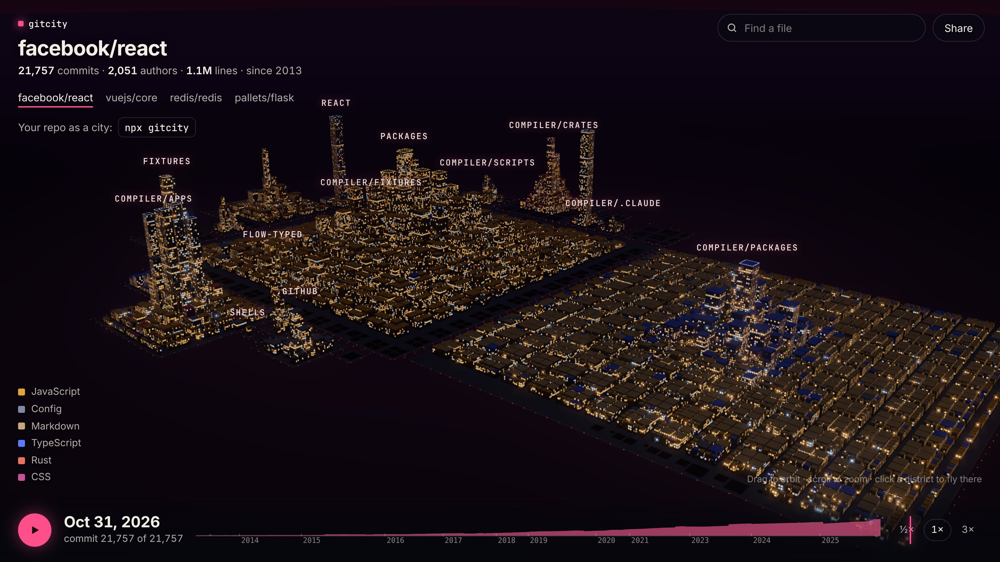
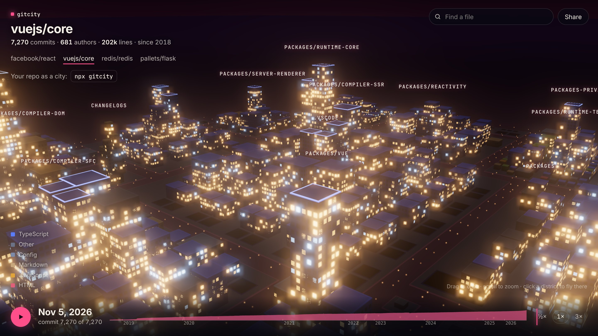
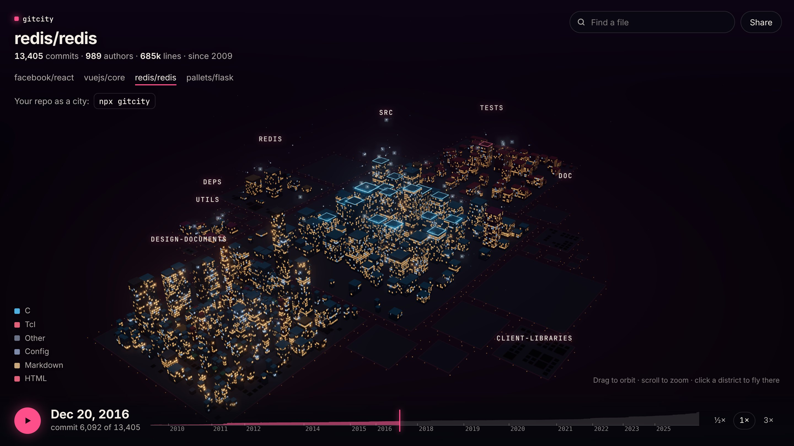

# gitcity

**Your git history as a 3D night city: every file a building, every commit a light coming on.**



<!-- GIF placeholder: replace with a short screen recording of the time-lapse (docs/timelapse.gif) -->

**[Live demo →](https://adywakes.github.io/Git-city/)** React, Vue, Redis and Flask, in your browser, nothing to install.

```bash
npx gitcity
```

Run it in any git repository. It reads the history, builds the city and opens it in your browser. Everything runs locally: no account, no telemetry, no network calls (except cloning, if you give it a URL).

## Usage

```bash
npx gitcity                                  # the repository in the current folder
npx gitcity ./path/to/repo                   # any local repository
npx gitcity https://github.com/vuejs/core    # clones it to a temp folder first (full clone, with progress)
npx gitcity vuejs/core                       # GitHub shorthand
```

| Option | What it does |
| --- | --- |
| `-n, --max-buildings <n>` | Render the largest `n` files (default 10000). Lower it for huge monorepos on slow laptops. |
| `-p, --port <port>` | Port for the local viewer (default 4173; the next free one is used). |
| `--host <host>` | Interface to bind (default `127.0.0.1`). |
| `--no-open` | Don't open the browser. |
| `--json <file>` | Write the city data to a file and exit. Load it later with `?data=<url>`. |
| `--keep` | Keep the temporary clone of a remote repository. |

Requires Node 20+ and git.

### In the city

- **Drag** to orbit, **scroll** to zoom, **right-drag** to pan, **double-click** to fly home.
- **Hover** a building for its file name, lines, commits and top author.
- **Click** a building or district to fly to it.
- **Find a file** with the search box (press `/`).
- **Play** (or press space) to grow the city from the first commit to today. Contributors appear as small lights flying to the files they change. Drag the timeline to scrub.
- **Share** exports a 1920×1080 or 1080×1920 PNG, or a 10-second time-lapse video (WebM).

| | |
| --- | --- |
|  |  |
| Vue core, close up | Redis in December 2016, mid time-lapse: contributor lights over `src` |

## How the mapping works

| City | Repository |
| --- | --- |
| District | A top-level folder. A folder that holds more than half the city (like `src/` or `packages/`) is split into its sub-folders. Files in the root form their own district. |
| Building | A file. Binary files are skipped. |
| Height | Lines of code, on a square-root scale, so one generated 50k-line file doesn't flatten everything else. |
| Footprint | Number of commits that touched the file: 1–9 commits is one lot, 10–99 two, 100–999 three, 1000+ four. |
| Color | Language, from a curated 12-tone night palette. |
| Neon crown | The tallest ~2.5% of buildings, your landmarks. |
| Dark empty lot | A file that was deleted. The largest ones are kept, at the edge of their district. |
| Downtown | Within each district the biggest files sit in the middle; the biggest districts sit in the middle of the city. |

The layout is deterministic: the same repository always gives the same city, so screenshots from different days line up.

Renames are followed (`git log -M`), so a moved file keeps its building. Merge commits don't count twice. Line counts are the sum of every commit's added minus deleted lines for that file, which matches `wc -l` at HEAD.

## Performance

- History is streamed from `git log -z --raw --numstat` and parsed incrementally; the raw log is never held in memory. A synthetic repository with 50,000 commits and 20,000 files peaks at ~140 MB of RAM, and almost all of the time goes to git computing diffs.
- The viewer draws every building in **one instanced draw call**. Windows are computed in the shader and fade to their average glow when they get smaller than a pixel (the shader's level of detail), and buildings smaller than ~1.5 px collapse entirely.
- The number of buildings is capped (largest files first, `--max-buildings`).
- Quality adapts to your GPU: if frames get slow, the pixel ratio drops first, then bloom turns off.

## How it works

```
git log ──stream──▶ parser ──▶ city builder ──▶ layout ──▶ city.json ──▶ local server ──▶ viewer (Three.js)
         (src/core/parser.ts) (builder.ts)    (layout.ts)                (src/node)       (viewer/src)
```

- `src/core/` is pure TypeScript with no Node or browser APIs: parser, model builder, layout, file format, palette. This is where the tests are focused.
- `src/node/` holds git access, cloning, the static server and the CLI pieces. No runtime dependencies.
- `viewer/` is a Vite + Three.js app. It is pre-built into `dist/viewer`, so the npm package works offline.

The city file format is documented in [`src/core/format.ts`](src/core/format.ts).

## Contributing

Contributions are very welcome, from bug reports to new city features.

```bash
git clone https://github.com/AdyWakes/Git-city.git
cd Git-city
npm install
npm test               # parser, layout and builder tests (Vitest)
npm run build          # CLI (tsc) + viewer (Vite)
node dist/cli.js .     # run it on this repo
```

Working on the viewer with hot reload:

```bash
node dist/cli.js /some/repo --json viewer/public-city.json   # any city file
npm run dev:viewer                                           # then open http://localhost:5173/?data=/public-city.json
```

Useful scripts:

- `node scripts/synth-repo.mjs /tmp/big --commits 50000 --files 20000` generates a big synthetic repository for performance work.
- `node scripts/build-demo-data.mjs` re-clones the demo repositories and regenerates `demo/data`.
- `node scripts/build-demo-site.mjs` assembles the static demo in `demo-site/`.
- `node scripts/shot.mjs <url> out.png` takes a headless screenshot (needs Playwright installed).

Guidelines:

- Keep the CLI dependency-free and the core deterministic (no `Math.random`, no `Date.now()` in layout).
- Any change to the parser or layout needs a test. `npm run typecheck && npm test` must pass.
- Visual changes: include a before/after screenshot in the PR.
- No telemetry and no network calls, ever, besides the explicit clone.

### Good first issues

1. **Add ESLint + Prettier** to CI, with a config that matches the current style.
2. **More languages in the palette mapping** (`src/core/languages.ts`): Julia, OCaml, Nim, Terraform, Protobuf… with tests in `test/builder.test.ts`.
3. **`--since <date>` / `--branch <name>` options** to build the city for part of the history or another branch (pass a revision range through `streamCommits`).
4. **Keyboard navigation of districts**: `[` and `]` to fly to the previous/next district, with an on-screen hint.
5. **An `.gitcityignore` file** (glob patterns) to leave generated or vendored folders out of the city, applied in `CityBuilder.finalize`.

## License

MIT
